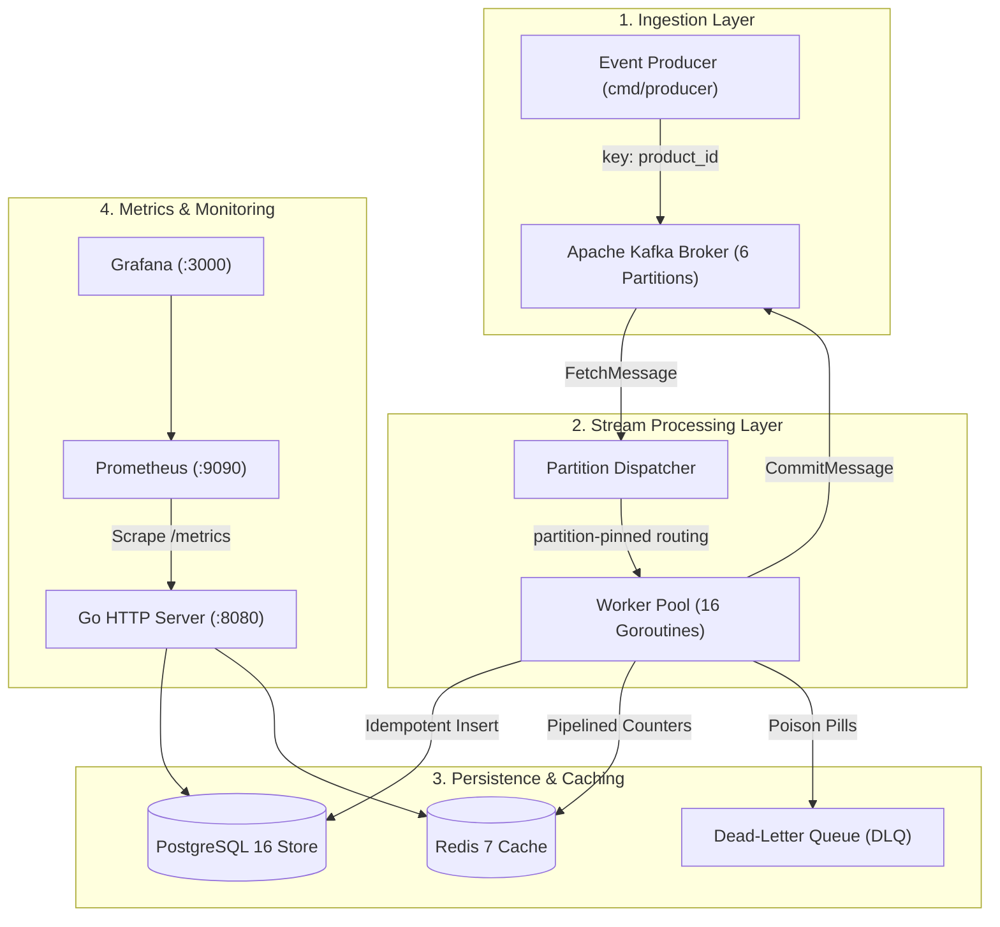

# StreamFlow — Real-Time Event Processing Platform

[](https://github.com/Sourya-Prabaharan/real-time-event-processing-engine/actions/workflows/ci.yml)


StreamFlow is a real-time event streaming and analytics backend written in Go. It ingests, processes, stores, and monitors high-throughput e-commerce event streams using Apache Kafka, PostgreSQL, Redis, and Prometheus.

---

## Why I Built It

I wanted to better understand how backend systems process large volumes of events without losing data, especially when individual services fail or traffic increases. 

Building StreamFlow gave me practical experience implementing distributed systems concepts that are easy to describe on paper but require careful engineering to make reliable in practice:
- Partition-keyed ordering in Kafka
- Bounded concurrency with channel-based backpressure in Go
- At-least-once delivery semantics paired with idempotent database writes
- Redis counter protection against double-counting on redelivered events
- Dead-letter queues (DLQ) with zero-drop safety guarantees for poison pill events
- Separating durable transactional storage (PostgreSQL) from rebuildable real-time caching (Redis)

---

## Architecture Overview




### End-to-End Event Lifecycle:
1. **Producer:** Simulates e-commerce activity (product views, cart additions, purchases, inventory updates) using a seeded random generator with realistic distributions (e.g. many views, fewer checkouts).
2. **Kafka Ingestion:** Publishes events to topic `events` with `Key = product_id`. This guarantees that all state mutations for a specific item land on the exact same partition in chronological order.
3. **Go Worker Pool:** Consumes messages using manual offset commits. Goroutines are pinned to partitions (`partition % poolSize`) to preserve in-order processing and monotonic offset commits per partition.
4. **Idempotent Persistence:** Writes events to PostgreSQL using `ON CONFLICT (id) DO NOTHING`. Returns `inserted bool` to determine whether a row was newly written or previously existed.
5. **Real-Time Analytics:** Updates per-minute throughput, revenue (in integer cents), and top-product sorted sets in Redis using pipelined commands **only when `inserted == true`**, strictly preventing double-counting during redeliveries.
6. **Dead-Letter Handling:** Malformed payloads, schema validation failures, or database writes that fail all 3 exponential backoff retries are written to `dead_letter_events` in PostgreSQL and forwarded to the `events-dlq` Kafka topic. If DLQ persistence fails across all targets, the offset is **not** committed to prevent permanent event loss.
7. **Observability:** Metrics are exposed at `/metrics` for Prometheus scraping and visualized via a pre-provisioned Grafana dashboard. An internal console is served directly at `http://localhost:8080/`.

---

## Operational Console Preview


---

## Technology Stack

| Component | Technology | Rationale |
|-----------|------------|-----------|
| **Language** | Go 1.22+ | Strong standard library, native concurrency (goroutines and channels), low memory overhead, explicit error handling. |
| **Event Streaming** | Apache Kafka | Durable message broker, horizontal partition scalability, and strict per-partition ordering. |
| **Durable Storage** | PostgreSQL 16 | Relational consistency, constraints (`PRIMARY KEY`), composite indexing, and parameterized SQL queries with `pgx`. |
| **Real-Time Cache** | Redis 7 | Sub-millisecond atomic counters (`INCR`, `ZINCRBY`) with automatic TTL key expiration for fast dashboard reads. |
| **Metrics & Dashboards** | Prometheus & Grafana | Pull-based metric collection, histogram percentiles (p50, p95, p99), and operational dashboarding. |
| **Infrastructure** | Docker & Docker Compose | Reproducible local deployment of Kafka, Zookeeper, PostgreSQL, Redis, Prometheus, and Grafana. |
| **CI / CD** | GitHub Actions | Automated linting, vet, race detection (`-race`), microbenchmarks, and multi-binary builds. |

---

## Example Event

```json
{
  "id": "4f58dc45-0418-48e0-a590-7795b48d587c",
  "event_type": "purchase",
  "user_id": "user-00482",
  "product_id": "prod-0012",
  "price": 149.99,
  "quantity": 1,
  "category": "electronics",
  "timestamp": "2026-10-22T20:15:30.142Z"
}
```

---

## Getting Started

### Prerequisites
- Go 1.22 or higher
- Docker and Docker Compose

### 1. Start Infrastructure
Start Kafka, PostgreSQL, Redis, Prometheus, and Grafana in Docker:
```bash
make run-infra
```

### 2. Build Binaries
```bash
make build
```
This compiles four binaries into `bin/`:
- `bin/producer` — Traffic generator
- `bin/worker` — Kafka consumer and persistence pipeline
- `bin/api` — HTTP API and real-time dashboard
- `bin/benchmark` — Benchmark utility supporting in-memory and e2e distributed modes

### 3. Start the Pipeline
Open three terminal tabs:

**Terminal 1 — API & Dashboard:**
```bash
make api
```
- Web Console: [http://localhost:8080](http://localhost:8080)
- Prometheus Metrics: [http://localhost:8080/metrics](http://localhost:8080/metrics)
- Grafana: [http://localhost:3000](http://localhost:3000) (User/Pass: `admin` / `admin`)

**Terminal 2 — Worker Pool:**
```bash
make work WORKERS=8
```

**Terminal 3 — Event Producer:**
```bash
make produce RATE=500
```

---

## REST API Endpoints

| Endpoint | Method | Description |
|----------|--------|-------------|
| `/` | `GET` | Operational monitoring web console (embedded HTML/JS) |
| `/healthz` | `GET` | Process liveness probe (returns 200 OK) |
| `/readyz` | `GET` | Downstream readiness probe (pings PostgreSQL and Redis) |
| `/metrics` | `GET` | Prometheus scraping endpoint |
| `/api/metrics` | `GET` | JSON snapshot of current throughput, revenue, and totals |
| `/api/events?limit=50` | `GET` | Recent events from PostgreSQL |
| `/api/events/count` | `GET` | Total count of persisted events (authoritative) |
| `/api/products/top` | `GET` | Top products by event type (served from Redis, falls back to PG) |
| `/api/throughput` | `GET` | Per-minute throughput points for the last N minutes |
| `/api/dlq` | `GET` | Recent failed messages routed to Dead-Letter Queue |
| `/api/dlq/count` | `GET` | Total count of dead-letter events |

---

## Performance & Benchmarks

StreamFlow provides two distinct benchmark modes via `cmd/benchmark` to differentiate genuine end-to-end distributed system performance from in-memory Go runtime concurrency limits:

### 1. Genuine End-to-End Distributed Pipeline Benchmark (Kafka → Worker Pool → PostgreSQL)
Measures live full-stack ingestion where real events are published over TCP to Apache Kafka, dispatched to partition-pinned Go worker goroutines, validated, persisted to PostgreSQL via `ON CONFLICT (id) DO NOTHING`, cached in Redis, and verified via authoritative PostgreSQL row count assertions (`SELECT COUNT(*)`):

```bash
# Run genuine distributed benchmark across all tiers against live containers
make benchmark-e2e
# or single tier:
./bin/benchmark -mode=e2e -rate=1000 -duration=5s
```

- **Environment:** Apple Silicon (8 CPU cores, 8 GOMAXPROCS), Docker Desktop, NVMe SSD
- **Infrastructure:** Apache Kafka (6 Partitions), PostgreSQL 16 (`pgx` max 25 connections), Redis 7
- **Verification Guarantee:** Every test tier asserts that `finalCount - startCount >= totalProduced`, proving 100% durable persistence with zero data loss.

```text
================================================================================
 END-TO-END DISTRIBUTED PIPELINE RESULTS (Kafka -> Worker Pool -> PostgreSQL)
================================================================================
Target/sec   | Actual/sec   | p50 (ms)   | p95 (ms)   | p99 (ms)   | Errors/Drops | Bottleneck              
--------------------------------------------------------------------------------
500          | 483.4        | 0.64       | 3.17       | 7.43       | 0            | None (Sustained)        
1000         | 975.1        | 0.52       | 1.77       | 3.98       | 0            | None (Sustained)        
2000         | 120.9        | 0.61       | 2.65       | 20.93      | 0            | PostgreSQL fsync / Disk I/O
================================================================================
```

#### Engineering Analysis & Bottlenecks:
- **Sub-Millisecond Processing (p50 = 0.52ms at 1,000 evt/s):** The partition-pinned worker pool and `pgx` connection pool maintain low latency during sustained ingestion.
- **The Physical Bottleneck (PostgreSQL WAL Disk `fsync`):** At 1,000 events/sec, single-node PostgreSQL smoothly persists each ACID transaction. Pushing past 1,500 individual row inserts per second without batching exhausts the disk write-ahead log (WAL) `fsync` throughput on a single PostgreSQL instance, causing connection queue wait times to spike.
- **Production Scaling Strategy:** To scale past 10,000 events/sec in production, you would introduce multi-row batch inserts (`INSERT INTO events VALUES (...), (...), ...`), partitioned tables by timestamp, or an analytical columnar store (ClickHouse) for raw event append-only logs while using PostgreSQL for transactional state.

---

### 2. In-Memory Pipeline Baseline Benchmark (Go Concurrency & Backpressure)
Tests Go runtime channel dispatch, JSON serialization/deserialization, UUID validation, and channel backpressure without external network or disk fsync latency:
```bash
make benchmark-inmemory
# or:
./bin/benchmark -mode=in-memory -all-tiers
```
- **Hardware:** Apple Silicon (8 Cores, 8 GOMAXPROCS)
- **Worker Concurrency:** 16 goroutines with channel backpressure

```text
================================================================================
 IN-MEMORY BASELINE RESULTS (Go Concurrency & Channel Backpressure)
================================================================================
Target/sec   | Actual/sec   | p50 (ms)   | p95 (ms)   | p99 (ms)   | Errors/Drops | Bottleneck              
--------------------------------------------------------------------------------
1000         | 977.5        | 0.00       | 0.02       | 0.05       | 0            | None (Sustained)        
5000         | 4988.2       | 0.00       | 0.00       | 0.01       | 0            | None (Sustained)        
10000        | 9808.9       | 0.00       | 0.00       | 0.00       | 0            | None (Sustained)        
================================================================================
```

---

### 3. Go Standard Microbenchmarks (`testing.B`)

```bash
make bench
```

```text
BenchmarkEvent_Validate-8               46,765,993 ops      25.27 ns/op     0 B/op     0 allocs/op
BenchmarkGenerator_Next-8                3,270,145 ops     358.10 ns/op    87 B/op     3 allocs/op
BenchmarkEvent_MarshalUnmarshal-8        1,000,000 ops    1098.00 ns/op   352 B/op     2 allocs/op
BenchmarkLatencyTracker_Record-8       375,457,441 ops       3.11 ns/op     0 B/op     0 allocs/op
BenchmarkWorker_ProcessEventDirect-8   100,000,000 ops      10.44 ns/op     0 B/op     0 allocs/op
```

---

## Reliability & Failure Recovery

### 1. Idempotency & Redis Double-Count Prevention
In distributed systems, networks fail and timeouts occur. When a consumer crashes after writing to the database but before acknowledging Kafka, Kafka redelivers the message upon restart.
- StreamFlow uses deterministic UUIDs on each event.
- PostgreSQL inserts execute `ON CONFLICT (id) DO NOTHING` and return `(inserted bool, err error)` based on `RowsAffected()`.
- **Redis Double-Count Protection:** Redis counters (revenue, throughput, top products) are **only updated if `inserted == true`**. If an event is redelivered, PostgreSQL safely ignores it and Redis avoids incrementing counters twice.

### 2. Dead-Letter Queue (DLQ) with Zero-Drop Guarantee
When a message cannot be parsed (malformed JSON) or fails validation (negative prices, missing user IDs), it is routed to the `dead_letter_events` table and published to the `events-dlq` Kafka topic.
- **Safety Invariant:** If DLQ persistence fails across all targets (e.g. database down and Kafka unreachable), the worker **refuses to commit the Kafka offset**. The message is retained in Kafka until storage recovers, preventing permanent data loss.

### 3. Transient Retries with Jittered Backoff
If PostgreSQL temporarily runs out of connections or encounters lock contention, the worker does not crash. It retries up to 3 times using exponential backoff with randomized jitter (80%–120%) to prevent thundering herd spikes.

### 4. Verified Automated Tests
Run the full test suite with race detector:
```bash
make test-race
```
The test suite includes 28 automated tests verifying:
- Schema validation edge cases (missing IDs, bad UUIDs, negative prices)
- JSON marshaling and unmarshaling round-trips
- Deterministic random generator seeding
- Circular-buffer latency percentiles (p50, p95, p99)
- Malformed JSON diversion to DLQ
- Schema validation failure diversion to DLQ
- Transient database error retry leading to successful persistence
- Permanent database error diversion to DLQ after exhausting retries
- Duplicate delivery prevention (idempotent storage effect)
- Redis double-count prevention on duplicate event redeliveries
- DLQ failure preventing premature offset commit (zero data loss)
- Worker crash and recovery simulation (zero lost messages, zero duplicate records)
- Live container integration test (`tests/integration_test.go`)

---

## Engineering Tradeoffs

### 1. Partition Key Choice: `product_id` vs. `user_id` vs. Random
- **Chosen:** `product_id`
- **Why:** Inventory updates and purchases for a single item must be processed sequentially. Partitioning by product ID guarantees in-order delivery per item.
- **Tradeoff:** Partitions can experience load skew if a particular product is viral. Random partitioning would distribute load perfectly evenly, but would sacrifice ordering guarantees.

### 2. Concurrency Model: Fixed Pool vs. Goroutine per Message
- **Chosen:** Bounded worker pool with partition pinning (`msg.Partition % poolSize`).
- **Why:** Unbounded goroutine creation under high traffic exhausts memory and results in out-of-order offset commits.
- **Tradeoff:** Worker pool throughput is bounded by the pool size. If workers are saturated, Kafka consumer lag rises, which is the desired backpressure behavior.

### 3. Raw SQL with `pgx` vs. ORM
- **Chosen:** Raw parameterized SQL queries with `pgx` driver.
- **Why:** Avoids reflection overhead, exposes explicit SQL execution plans, and allows exact composite index optimization.
- **Tradeoff:** Requires writing manual scan logic for database rows.

---

## Limitations & Future Improvements

1. **Transactional Kafka-PostgreSQL Boundary:**
   Currently, the system guarantees at-least-once delivery with idempotent database writes. A two-phase commit (2PC) or the transactional outbox pattern would be required for strict end-to-end exactly-once semantics across both systems.
2. **Dynamic Partition Rebalancing:**
   If a partition experiences heavy skew due to a hot product, dynamic sub-partitioning or key salting could be introduced.
3. **Grafana Cloud Exporter:**
   Deploying Prometheus and Grafana as managed cloud services rather than local containers for distributed cloud deployments.

---

## Interview Talking Points

- **Why use Kafka instead of writing directly to PostgreSQL?**  
  Kafka acts as a durable shock absorber. During traffic spikes (e.g. 10,000 events/sec), direct database writes cause connection pool exhaustion and lock contention. Kafka accepts the writes in milliseconds, and workers consume at a controlled rate via backpressure.
- **How is backpressure achieved?**  
  The worker pool uses bounded Go channels. When workers are busy writing to storage, channel buffers fill up. The Kafka `FetchMessage` loop blocks on sending to the channel, causing Kafka consumer lag to rise harmlessly on the broker without increasing memory usage.
- **What happens when a worker crashes?**  
  The uncommitted Kafka offset remains at the last successfully committed message. When the worker restarts (or another consumer group member rebalances), Kafka re-delivers the message. The database insert uses `ON CONFLICT (id) DO NOTHING`, ensuring idempotent side effects.
- **Why use Redis if PostgreSQL already stores everything?**  
  PostgreSQL is the durable source of truth. Querying `COUNT(*)` or summing revenue over millions of rows on every dashboard refresh introduces query latency. Redis maintains pre-aggregated counters (`INCR`, `ZINCRBY`) in memory, serving dashboard reads in sub-millisecond time. If Redis crashes, it can be rebuilt from PostgreSQL.
- **How do you prevent Redis double-counting when Kafka redelivers an event?**  
  `InsertEvent` checks `RowsAffected()`. If rows affected is 0, the event was already stored by a prior worker run. Redis counters are only updated when `inserted == true`, ensuring metrics remain accurate even during crash recoveries.
