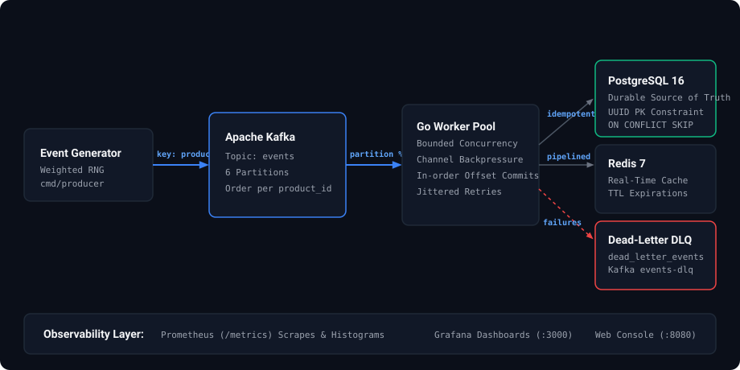
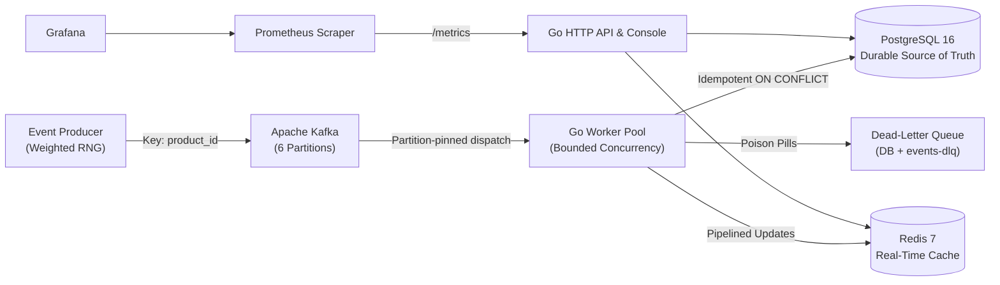

# StreamFlow Architecture & Engineering Design

This document details the internal design, concurrency patterns, data flow, failure recovery models, and engineering tradeoffs of **StreamFlow**.

---

## 1. System Overview

StreamFlow processes real-time e-commerce activity (product views, cart additions, purchases, inventory updates) across a distributed pipeline:





---

## 2. Ingestion & Partitioning Strategy

### Partition Keying
Every event published to the Kafka topic `events` uses `product_id` as its message key.

- **Why `product_id`?**
  In e-commerce systems, state mutations for a specific item (e.g. inventory decrements after a purchase, price adjustments, stock replenishments) must be processed chronologically. Because Kafka guarantees strict in-order delivery **within a single partition**, assigning `key = product_id` guarantees that all events for that product land on the exact same partition in the exact order they occurred.

- **Tradeoff:**
  Certain viral or flash-sale products generate significantly more events than others, causing partition load skew. We deliberately accepted this tradeoff because business correctness (avoiding negative inventory and out-of-order purchase state) is strictly more important than uniform partition distribution.

### Batching & Acknowledgment
- **Producer Configuration:**
  - `RequiredAcks: kafka.RequireOne` ensures the leader broker persists the message before returning success.
  - Configurable batch window (`BatchTimeout: 10ms`, `BatchSize: 100`) allows high throughput while keeping generation latency sub-millisecond.

---

## 3. Worker Concurrency & Backpressure

### Partition-Pinned Goroutine Pool
Rather than spawning an unbounded goroutine per message (which causes memory exhaustion and out-of-order offset commits), the worker implements a fixed-size goroutine pool:

1. **Dispatcher Routine:** Fetches messages sequentially from Kafka using `FetchMessage`.
2. **Partition Pinning:** The message is routed to worker queue `msg.Partition % poolSize`.
3. **Sequential Processing:** Because each partition is mapped to a dedicated channel and worker, messages for that partition are executed in offset order.
4. **Natural Backpressure:** Each partition channel has a fixed buffer (100 items). When downstream storage slows down, the channels fill up, the fetch loop blocks on channel send, and Kafka consumer lag rises harmlessly on the broker instead of crashing the Go runtime with Out-Of-Memory (OOM) errors.

---

## 4. Reliability & Failure Recovery

### At-Least-Once Delivery with Idempotent Persistence
StreamFlow guarantees **at-least-once** delivery with idempotent side effects, avoiding duplicate records:

```
Step 1: FetchMessage from Kafka (offset uncommitted)
Step 2: Deserialize & validate event schema
Step 3: Execute PostgreSQL insert (ON CONFLICT (id) DO NOTHING) with exponential backoff -> returns (inserted bool, err)
Step 4: Update Redis cache counters ONLY if inserted == true (strictly prevents double-counting on redelivery)
Step 5: CommitMessage offset to Kafka
```

#### Crash Scenario Analysis:
- **Worker crashes before DB write:** The offset was never committed. Upon restart, Kafka re-delivers the message. The new worker processes it normally.
- **Worker crashes after DB write, before offset commit:** Upon restart, Kafka re-delivers the message. The worker attempts to insert the event into PostgreSQL, but `ON CONFLICT (id) DO NOTHING` skips the duplicate UUID primary key and returns `inserted = false`. The worker then skips Redis incrementation (preventing double-counting) and commits the offset. Zero duplicate rows created, zero counter inflation.
- **Redis crashes:** PostgreSQL is the durable source of truth. Redis updates are logged as warnings and do not fail the pipeline. Redis can be fully rebuilt from the authoritative `events` table.

### Transient Failure Retries with Exponential Backoff
Downstream database hiccups (e.g., connection pool exhaustion or momentary lock contention) are handled by `internal/retry`:
- Max attempts: 3
- Initial backoff: 50ms with a 2.0x multiplier
- Full random jitter (80% to 120%) to avoid thundering herd spikes when the database recovers.

### Dead-Letter Queue (DLQ) & Zero-Drop Guarantee
Messages that cannot be processed are never silently dropped or allowed to block the partition indefinitely (poison pills):
- **Permanent failure triggers:** Malformed JSON, missing required fields, invalid UUIDs, or database errors that exhaust all 3 retry attempts.
- **DLQ routing:** The message is persisted to the `dead_letter_events` table in PostgreSQL and forwarded to the `events-dlq` Kafka topic with diagnostic headers.
- **Zero-Drop Safety Invariant:** If DLQ persistence fails across all targets (e.g., database network partition and Kafka unreachable), the worker **refuses to commit the offset**. The message is retained in Kafka until storage recovers, preventing permanent data loss. Only after successful DLQ persistence is the message offset safely committed.

---

## 5. Storage Schema & Indexing Rationale

### `events` Table
```sql
CREATE TABLE IF NOT EXISTS events (
    id          UUID PRIMARY KEY,
    event_type  VARCHAR(32) NOT NULL,
    user_id     VARCHAR(64) NOT NULL,
    product_id  VARCHAR(64) NOT NULL,
    price       DECIMAL(10,2),
    quantity    INTEGER DEFAULT 1,
    category    VARCHAR(64),
    metadata    JSONB,
    created_at  TIMESTAMPTZ NOT NULL,
    ingested_at TIMESTAMPTZ NOT NULL DEFAULT NOW()
);
```

### Why Each Index Exists:
1. `PRIMARY KEY (id)`: Enforces uniqueness for idempotency via `ON CONFLICT (id) DO NOTHING`.
2. `CREATE INDEX idx_events_type ON events(event_type)`: Accelerates filtering by activity (e.g., all purchases vs. all product views).
3. `CREATE INDEX idx_events_product_id ON events(product_id)`: Speeds up per-product audit queries.
4. `CREATE INDEX idx_events_created_at ON events(created_at)`: Powers time-windowed reporting.
5. `CREATE INDEX idx_events_type_created ON events(event_type, created_at)`: Composite index covering the most frequent dashboard query pattern ("events of type X in the last N minutes") without scanning the entire table.

---

## 6. Real-Time Caching Strategy (Redis)

Redis is utilized strictly as a rebuildable operational layer:
- **Throughput Counters:** `throughput:YYYY-MM-DDTHH:MM` (incremented per event, 1-hour TTL).
- **Revenue Counters:** `revenue:YYYY-MM-DDTHH:MM` stored in **integer cents** to eliminate floating-point precision errors (1-hour TTL).
- **Top Products:** `top:<event_type>:YYYY-MM-DD` stored in Redis Sorted Sets (`ZINCRBY`, scored by count, 25-hour TTL).
- **Pipelining:** All updates for an event are executed in a single pipelined command round-trip.
